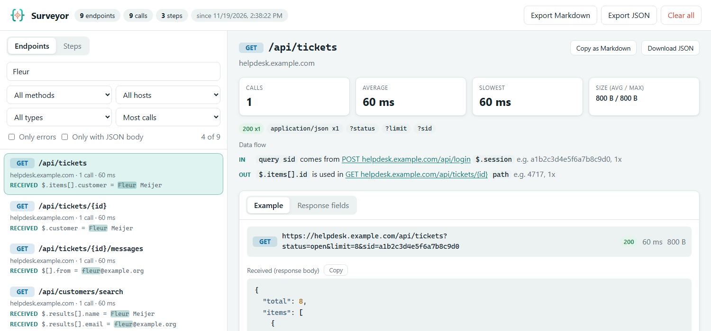
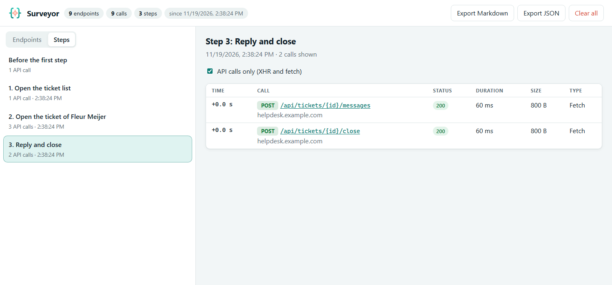
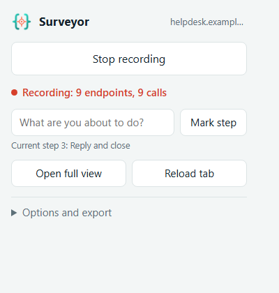

<p align="center">
  
</p>

<h1 align="center">Surveyor</h1>

<p align="center">
  <b>The missing manual for undocumented APIs.</b><br>
  Click through any web system. Surveyor records the calls behind it and writes down how it works: endpoints, fields,
  real example responses, the steps of each task and the data passed between calls.
</p>

<p align="center">
  <a href="https://github.com/lexvanwalsem/surveyor/actions/workflows/test.yml"></a>
  
  
  
  
</p>

<p align="center">
  
</p>

## The problem

Plenty of systems have a web interface that works and API documentation that does not exist, is out of date or leaves
out half of what you need. The interface already calls the backend for everything it shows. That knowledge is just buried
in a long list of requests.

Surveyor digs it out while you use the system, and leaves you with the documentation nobody wrote.

## What Surveyor does

You use the web app as you normally would. Surveyor watches the calls the page makes to its backend and turns them into
something you can read, search and share:

- **Every endpoint on one screen**, grouped and named, with timing, size and status.
- **Every field** of every request and response, with its type and how often it appears.
- **Real example calls**: the full URL, what was sent, what came back, as formatted JSON.
- **The story of what you did**: the calls grouped per step ("open the ticket", "reply", "close").
- **The links between calls**: this id came from that response.

It works on any site, on a tab that is already open, without a proxy, certificates, command line or account.

## How it is different

Good tools already exist that turn browser traffic into an OpenAPI specification, for example
[OpenAPI DevTools](https://chromewebstore.google.com/detail/jelghndoknklgabjgaeppjhommkkmdii),
[demystify](https://github.com/tfmorris/demystify) and
[API Network Recorder](https://chromewebstore.google.com/detail/jbanbhbcmngjfdchpiimomffibimbckl). A specification
tells you which endpoints exist and what their schemas look like. When you have to integrate with a system, that is half
the answer. The other half is how it **behaves**: which calls make up one task, in what order, and which values travel
from one call to the next.

Surveyor is built around that second half:

- **Steps** show which endpoints one action in the interface triggers.
- **Data flow** shows where a value comes from and where it is used again.
- **Search by value** finds the endpoint and field behind anything you can see on screen.
- **Real examples of every kind of body**, not only JSON: HTML, XML, form data and plain text too.
- **Privacy by design**: request headers are never stored and everything stays on your computer.

Use it next to a spec generator or instead of one. An OpenAPI export is on the list below.

## Why use it

This is what changes compared with working in the Chrome DevTools Network tab alone:

| You want to know | Without Surveyor | With Surveyor |
|---|---|---|
| Where does this number on screen come from? | Open request after request until you spot it | Type the number. The endpoints that returned it are listed with the exact field, and the field opens |
| What does clicking "Close ticket" trigger? | Clear the log, click, read the new rows, remember them | Mark a step, click. The step lists exactly its calls, in order |
| Which endpoints exist? | A list where `/orders/1001` and `/orders/1002` are separate rows | One row per endpoint, ids become `{id}`, JSON-RPC and GraphQL are split by what they call |
| Which fields can be missing? | Compare several responses by hand | Every field shows its type and how often it is present |
| How do calls depend on each other? | Notice an id in one response and recognise it in a later URL | Shown as data flow: `POST /tickets/{id}/close` takes its `id` from `GET /tickets` |
| What does an endpoint return? | Open one request at a time and switch to the response | Example calls per endpoint, with the URL, query values and formatted JSON |
| Keep the result | Lost when DevTools closes or the log is cleared | Kept in the browser, exported as Markdown or JSON |
| Share it with a colleague | Send a HAR file: a raw dump with every request | A readable report per endpoint, filtered to what matters |
| Know what a page sends to third parties | Scroll for other hostnames | Every host is recorded and can be filtered |

It does not replace DevTools. It is what you reach for when the question is "how does this system work", instead of
"why did this one request fail".

### Good for

- **Integrating with a system** that has poor or no API documentation.
- **Documenting a legacy system** while you click through it.
- **Bug reports and QA**: attach the exact steps and calls instead of a screenshot.
- **Analysts and support**: find out which service a figure on a dashboard really comes from.
- **Vendor evaluation and migration**: see what a product's own interface depends on.
- **Security and privacy reviews**: see which hosts a page talks to and what it sends them.
- **Onboarding**: give a new developer a map of a system on their first day.

## What you get

### Find where a value comes from

Type a name, an order number or an amount you see on screen. Every endpoint that returned or received it is listed with
the field and the value, for example `RECEIVED $.items[].customer.name = Fleur Meijer`. Click it and the field opens.

### Follow what an action triggers

Type what you are about to do and press **Mark step**. The **Steps** view then shows the calls of each step in order,
with time since the step, status, duration and size. Click a call to jump to its endpoint.

<p align="center">
  
</p>

### See how calls depend on each other

When a value returned by one call (an id, a token, a code) is used again in a later path, query string or body, the link
is shown on both endpoints: where a value comes from and where it goes. That is the sequence you need to reproduce a
workflow.

### Understand the data

Per endpoint every request and response field with its type, how often it is present (so optional fields stand out) and
examples. JSON and form data are broken down into fields. HTML, XML and plain text are kept as text. Binary files and very
large responses are listed with their type and size.

### Read the real thing

Example calls show the full URL including query values, what was sent and what came back, as colour-coded formatted
JSON with a copy button.

### Find the problems

Errors are flagged with a count. Average and slowest time and the transfer size are shown per endpoint. You can filter on
errors, method, host and request type, and sort on calls, speed or recency.

### Take it with you

**Export Markdown** gives a readable report (endpoints, steps, data flow, examples) to read, share or paste into a ticket.
**Export JSON** gives the data for other tools. Both follow your current filters.

<p align="center">
  
</p>

## Install

Surveyor is not in the Chrome Web Store. Load it as an unpacked extension (takes a minute):

1. Download or clone this repository.
2. Open `chrome://extensions` and switch on **Developer mode**.
3. Click **Load unpacked** and select the root folder of this repository (the folder that contains `manifest.json`).
4. Pin the extension (puzzle icon, then the pin) so the icon stays visible.

After changing the code, press the refresh icon on the extension card.

## Use

1. Open the web app in a tab and click the Surveyor icon.
2. Press **Record this tab**. Chrome shows a bar saying "Surveyor started debugging this browser".
   Leave it open: closing it stops the recording.
3. Before each thing you do, type a short description in the step field and press **Mark step**
   ("open the ticket", "reply", "close"). This is optional, but it makes the result much easier to read.
4. Use the app as you normally would. Press **Reload tab** if you also want the calls made while the page loads.
5. Click **Open full view** to search, filter and inspect. Switch between **Endpoints** and **Steps** at the top left.
   **Export Markdown** or **Export JSON** takes the result with you.

## A Markdown export looks like this

````markdown
## POST shop.example.com/web/dataset/call_kw/mail.message/search_read [mail.message.search_read]

- Calls: 9, average 164 ms, max 208 ms
- Transfer size: average 4.1 KB, max 4.1 KB
- Status codes: 200 x9
- Request content types: application/json x9
- Response content types: application/json x9

Example call: `POST https://shop.example.com/web/dataset/call_kw/mail.message/search_read` -> 200 (208 ms, 4.1 KB)

Response

```json
{ "jsonrpc": "2.0", "result": [{ "id": 8, "subject": "Where is my order 8?", "author_id": [8, "Fleur Meijer"] }] }
```

Response fields

| Field | Type | Present | Examples |
|---|---|---|---|
| $.result[].subject | string | 100% | Where is my order 8? |
| $.result[].author_id | array | 100% | |
````

The export starts with a **Steps** section and a **Data flow** section when you used them.

## Built to be trusted

- **Everything stays on your computer.** No server, no account, no analytics, no network requests of its own.
- **Request headers are not stored.** The only header it looks at is `Content-Type`, to know how to read a body.
  Cookies, authorization headers and tokens never enter the recording.
- **You decide what is kept.** With **Keep example data** off, only field names and types are kept.
- **No dependencies and small enough to read.** About a thousand lines of plain JavaScript, no build step, no packages
  to trust. You can review all of it in an afternoon.
- **Tested.** Automated tests run on every change.
- **Open source** under the MIT license.

### Privacy details

- The recording lives in `chrome.storage.local` until you press **Clear** or remove the extension.
- Example data and remembered values (for search and data flow) can contain personal data or secrets that appear in URLs
  and bodies. They are shortened, and they stay local. Treat exports like the data they come from: do not commit or share
  them if they hold customer data.
- Record only systems you are allowed to look into, and respect their terms of use.

### Why these permissions

| Permission | Used for |
|---|---|
| `debugger` | Reads the Network events of the one tab you switch on, the same source as the DevTools Network tab. This is what makes response bodies readable. Chrome shows its "debugging" bar while it is active. |
| `storage` | Keeps the recording and your settings on your computer. |
| `unlimitedStorage` | Lifts Chrome's 10 MB limit on that storage, because recordings with example data can grow large. |
| `activeTab` | Shows which site the current tab is. |

There are no host permissions and no code runs inside the pages you visit.

## How it works

Surveyor attaches the Chrome debugger to the tab and listens to its Network events. For each finished call it collects
method, URL, status, timing and size, and asks for the response body. `capture.mjs` turns the events into calls,
`recorder.mjs` groups them per endpoint, infers the field structure, keeps the examples and finds the links between
calls. `viewer.html` shows the result, `popup.html` controls the recording.

How an identifier is recognised for the data flow: a token or code (6 to 100 characters without spaces, with a digit or at
least 16 characters), or a number of 10 or more in a field named like `id`, `token`, `key` or `code`. Links are a strong
hint, not proof: check them. The newest call that returned a value is taken as its source.

## Limits

- WebSocket and Server-Sent Events traffic is not captured.
- Request headers are not read, so tokens sent in headers are not followed in the data flow.
- Bodies are read up to 50 MB; larger responses are listed with their size but without content.
- Binary bodies (images, PDF, archives) are not shown, only their type and size.
- Multipart uploads are listed, but their parts are not broken down.
- Example calls are shortened: the first 3 items of lists, texts cut at 200 characters (4000 for text bodies),
  60 keys per object and 8 levels deep. The field structure and the value search look at the first 20 items of each list,
  and remember up to 200 distinct values per endpoint.
- The call log keeps the last 5000 calls and the data flow the last 3000 identifier values.
- You only learn about what you click: calls you never trigger are not documented.
- Chrome internal pages (`chrome://`) and the Chrome Web Store cannot be recorded.

## What is next

Not promises, but where it is going: export as an OpenAPI specification and TypeScript types, your own descriptions per
endpoint and field that end up in the export, a complete manual as one document, copy a call as cURL or fetch, compare two
recordings, detect pagination and authentication, and record WebSockets. Issues and pull requests are welcome.

## Development

No build step and no dependencies. Node.js 20 or newer is only needed for the tests.

```sh
npm test
```

| File | Role |
|---|---|
| `manifest.json` | Extension manifest (Manifest V3) |
| `background.js` | Service worker: attaches the debugger, stores calls |
| `capture.mjs` | Network events to finished calls (pure logic) |
| `recorder.mjs` | Grouping, field inference, examples, steps, value search, data flow, Markdown report (pure logic) |
| `popup.html`, `popup.js` | Toolbar popup |
| `viewer.html`, `viewer.js`, `viewer.css` | Full view page |
| `styles.css` | Shared design tokens and components |
| `test/` | Unit tests (`node --test`) |

## Contributing

Contributions are welcome as pull requests. The `main` branch is protected: every change is reviewed and approved by the
maintainer before it is merged. See [CONTRIBUTING.md](CONTRIBUTING.md). To report a security problem, see
[SECURITY.md](SECURITY.md).

## License

[MIT](LICENSE). You may use, copy and modify the code in your own version. Changes to this repository are only
accepted through pull requests that the maintainer approves.
